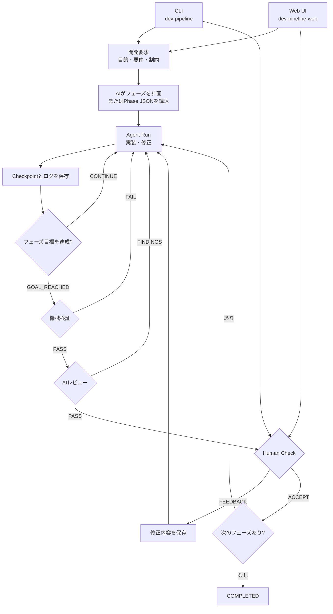

# AI開発パイプライン

開発要求を複数のフェーズへ分け、Coding Agentによる実装、機械検証、AIレビュー、人間の承認を順番に進めるローカル実行基盤です。
操作方法は、ターミナルから直接実行するCLIと、PC・スマートフォン向けWeb UIの2通りです。どちらも同じ `work/` の状態と成果物を扱います。

## パイプライン全体



機械検証とAIレビューが通っても自動承認はしません。成果物を実際に確認し、各フェーズで `ACCEPT` または `FEEDBACK` を入力します。状態、結果、ログはファイルへ保存されるため、プロセス終了後も再開できます。

## 必要環境とインストール

- Python 3.11以上
- Git
- 利用するAgent CLI（Codex、OpenCode、Antigravityのいずれか）とその認証

```bash
python3 -m venv .venv
source .venv/bin/activate
python -m pip install -e '.[web]'
```

CLIだけを使う場合は `python -m pip install -e .` でも構いません。インストール後は次の2コマンドが利用できます。

- `dev-pipeline`: パイプラインを直接操作するCLI
- `dev-pipeline-web`: 同じCLIをバックグラウンド実行するWeb UI

## CLIで直接実行する

新規案件用のGitリポジトリを準備し、要求を渡します。`--repo` を省略した場合の成果物保存先は `work/<案件ID>/repo/` です。

```bash
mkdir -p work/INIT-001/repo
git init work/INIT-001/repo

dev-pipeline --agent codex init \
  --id INIT-001 \
  --request "チームで使える軽量なタスク管理Webアプリを作る" \
  --constraint "SQLiteで動作すること"
```

`init` は計画後、最初のフェーズを実装・検証・レビューし、Human Check待ちまで進めます。結果を確認して承認する場合は次のように続けます。

```bash
dev-pipeline show INIT-001
dev-pipeline human-check INIT-001 ACCEPT
dev-pipeline --agent codex run INIT-001 --until-ready
```

修正が必要な場合：

```bash
dev-pipeline human-check INIT-001 FEEDBACK \
  --feedback "検索後に戻っても条件を保持してほしい"
dev-pipeline --agent codex run INIT-001 --until-ready
```

既存リポジトリの指定、固定フェーズ、検証コマンド、停止後の再開、Agentの切り替えを含む全手順は[CLI操作ガイド](docs/cli-operations.md)を参照してください。

## Web UIで操作する

ローカルで起動します。

```bash
dev-pipeline-web --work-dir /絶対パス/work
```

PCのブラウザーで `http://127.0.0.1:8787` を開きます。Web UIは新規依頼、進捗・ログ確認、承認、修正依頼、停止・再開を提供します。成果物自体を配信・実行する画面ではありません。

スマートフォンからの接続、Tailscale、通知は[Web UI・スマートフォン操作ガイド](docs/mobile-operations.md)、macOSでの常時起動は[launchd常時起動ガイド](docs/launchd.md)を参照してください。

## 保存先

```text
work/INIT-001/
├── initiative.json             # 案件の目的・要件・フェーズ順・固定検証
├── state.json                  # 現在の状態（Source of Truth）
├── usage.json                  # トークン使用量・Agent割り当て使用率
├── repo/                       # 既定の成果物リポジトリ
├── phases/                     # フェーズ定義
├── runs/                       # RunごとのCheckpoint
├── feedback/                   # ACCEPT / FEEDBACKの記録
├── evidence/                   # 検証・レビュー結果
└── agent-logs/                 # Agent呼び出しの詳細ログ
```

外部リポジトリを `--repo` で指定した場合、成果物は `work/` の外に置かれます。再開時も同じ `--work-dir`、案件ID、リポジトリを使用してください。

## ドキュメント

- [CLI操作ガイド](docs/cli-operations.md): ターミナルからの作成、実行、確認、承認、再開
- [Web UI・スマートフォン操作ガイド](docs/mobile-operations.md): 画面操作、Tailscale、通知
- [launchd常時起動ガイド](docs/launchd.md): macOSログイン時の自動起動と管理
- [トラブル対応](docs/troubleshooting.md): 利用者・管理者向けの切り分け
- [業務仕様](spec.md): 役割、承認基準、安全上の境界
- [Antigravity実行安定性 調査レポート](docs/antigravity-stability-report.md): 既知の挙動と改善案

## 利用上の注意

- 自動テストとAIレビューの合格は、業務上の正しさを保証しません。承認前に成果物を実際に確認してください。
- `human-check ... ACCEPT` は取り消しを前提としていません。
- 実行停止やプロセス終了は、それまでのファイル変更を取り消しません。
- Agentログには要求やソース内容が含まれる場合があります。共有前に内容を確認してください。
- パイプラインの完了は、本番公開やデプロイを意味しません。

## 開発時の検証

```bash
python3 -m unittest discover -v
python3 -m compileall -q dev_pipeline tests
```
