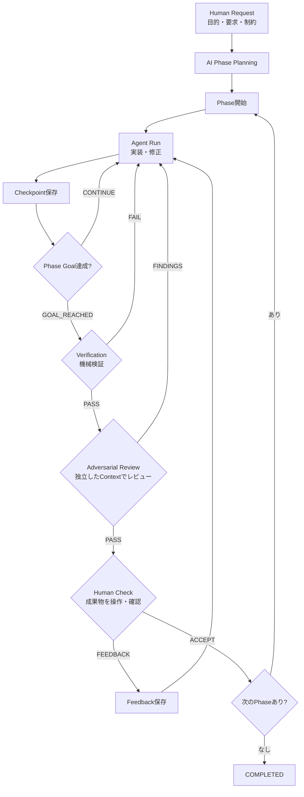

# AI Development Pipeline

`spec.md` の設計を実行可能なCLIにした、Phase指向のCoding Agentハーネスです。人間の要求を
レビュー可能な複数Phaseへ分割し、Agent Run、Checkpoint、機械検証、敵対的レビュー、
Human Checkを永続的な状態機械としてつなぎます。

## 実装済みのフロー



`init` はPhase開始まで、`run --until-ready` はHuman Check待ちまでを進めます。
Human Checkは自動承認せず、`human-check` でACCEPTまたはFEEDBACKを入力します。

* `initiative.json`、`state.json`、Phase定義を `work/<ID>/` に保存
* RunごとにMarkdown CheckpointとAgentログを保存
* 任意個のbuild/test/lintコマンドを実行し、結果とログをEvidenceとして保存
* 実装時とは独立したAgent呼び出しで、Reject理由を探す敵対的レビューを実行
* `ACCEPT` で次Phaseを自動開始し、`FEEDBACK` で同じPhaseのFix Runを開始
* stdin/stdoutの共通契約を介したCodex/OpenCodeアダプター
* JSONのatomic writeによる、Sessionに依存しない再開可能な状態管理

## 必要環境

* Python 3.11以上
* 利用するAgent CLI (`codex` または `opencode`) とその認証

インストールせずに `python -m dev_pipeline.cli` でも実行できます。CLIコマンドとして導入する場合：

```bash
python -m pip install -e .
dev-pipeline --help
```

## クイックスタート

### 開発リポジトリの置き場（運用ルール）

新規開発では `work/<ID>/repo/` を基本の置き場とします。別の場所を使いたい場合や
既存リポジトリを改修する場合は、その場所を `--repo` で指定します。
これは運用上の取り決めであり、CLIが自動で配置するものではありません。

`--repo` の省略時はカレントディレクトリが使われ、指定したパスも保存されません。
Planning・実装・検証・レビューの実行時には、再開時も含めて同じ `--repo` を明示してください。
相対パスはCLIを起動したディレクトリから解決されるため、以下の例は同じディレクトリで実行します。

### 1. 自然言語の要求から開始

新規開発では、先に成果物用のディレクトリを作成し、Gitリポジトリとして初期化します。
既存リポジトリを使う場合は作成不要で、以下の `--repo` をそのパスに置き換えます。

```bash
mkdir -p work/INIT-001/repo
git init work/INIT-001/repo
```

同じリポジトリを対象にPlanningします。Planningは人間の承認待ちで停止せず、
Phase 1を即座に `running` にします。`init` 自体は成果物を実装しません。

```bash
dev-pipeline --repo work/INIT-001/repo --agent codex init \
  --id INIT-001 \
  --request "チームで使える軽量なタスク管理Webアプリを作る" \
  --constraint "SQLiteで動作すること"
```

Phaseを明示して再現性のある開始をする場合は、サンプル形式のJSONを渡します。この場合のみ
Planning Agentを呼びません。

```bash
dev-pipeline --repo work/INIT-001/repo init --id INIT-001 \
  --goal "タスク管理アプリを完成させる" \
  --requirement "タスクを登録・完了できる" \
  --phase-file examples/phases.json
```

### 2. Agent Runを実行

AgentはRepositoryを直接変更し、最終出力に共通JSON契約を返します。`GOAL_REACHED` の場合は指定した
VerificationとAdversarial Reviewまで自動で進み、`CONTINUE` ならCheckpointを残して終了します。

```bash
dev-pipeline --repo work/INIT-001/repo --agent codex run INIT-001 \
  --check 'test=python -m unittest discover -v' \
  --check 'build=python -m build'
```

Human Checkまで自律的に継続する場合は `--until-ready` を指定します。`CONTINUE`、検証失敗、
レビュー指摘から次Runへ進み、Checkpoint・検証ログ・レビュー指摘を次のAgentへ渡します。
Human Checkは自動承認しません。Agentプロセス自体の起動・認証エラーは報告して終了します。

```bash
dev-pipeline --repo work/INIT-001/repo --agent codex run INIT-001 --until-ready \
  --check 'test=python -m unittest discover -v'
```

Codexの既定コマンドは `codex exec --sandbox workspace-write -` です。
認証済みCodex CLIの設定を使用し、モデルは固定しません。

OpenCodeでは同じコマンドの `--agent` を `opencode` に替えます。既定では
`opencode run --format json --dir <repoの絶対パス>` を起動し、JSONイベントから
最終回答だけを共通契約として取り出します。モデルはOpenCodeの設定を使用します。

```bash
dev-pipeline --repo work/INIT-001/repo --agent opencode run INIT-001 --until-ready \
  --check 'test=python -m unittest discover -v'
```

OpenCodeの最終回答が不正JSONの場合は、同じセッションに内容を変えず再出力を求めます。
権限拒否で回答前に終了した場合は、拒否を尊重し、許可範囲内の代替確認を促します。
復帰は1呼び出しにつき合計2回までで、権限の自動承認や設定変更はしません。
認証・API・プロセスエラーや復帰上限超過はログの場所を表示して停止します。
必要な権限が本当に不足している場合は、運用側で内容を確認してください。

各呼び出しのコマンド・Prompt・stdout・stderr・終了コードは、失敗分も含めて
`work/<ID>/agent-logs/` に保存します。ログには要求やソース内容が含まれ得るため、
共有時は内容を確認してください。検証済みのレビュー工程で停止した場合も、同じ
`run --until-ready` コマンドで保存済み状態から再開できます。

CLIオプションと権限の詳細は[OpenCode CLI](https://opencode.ai/docs/cli/)・
[Permissions](https://opencode.ai/docs/permissions/)を参照してください。
実機での復帰確認と新規E2Eの結果は[OpenCode実機検証](docs/opencode-e2e.md)に記録しています。

AgentのCLI引数が環境と異なる場合はコマンドを差し替えられます。Promptはstdinに渡されます。
`--agent-command` は選択したアダプターの起動コマンドを上書きします。
OpenCodeを選択した場合は、上書きしてもイベント抽出・セッション復帰を維持します。
OpenCode用のコマンドには `--format`・`--dir`・`--session` を含めず、アダプターに任せてください。
汎用の生JSON出力コマンドを使う場合は `--agent command --agent-command '任意のCLI'` とします。
以前の `--agent opencode --agent-command '生JSONを返す独自CLI'` も、この指定に変更してください。

```bash
dev-pipeline --repo work/INIT-001/repo --agent codex \
  --agent-command 'codex exec --sandbox workspace-write -' run INIT-001 \
  --check 'test=pytest -q'
```

### 3. 状態確認とHuman Check

```bash
dev-pipeline status INIT-001

# 成果物を操作して問題がなければ次Phaseへ
dev-pipeline human-check INIT-001 ACCEPT

# 修正が必要なら同じPhaseを継続
dev-pipeline human-check INIT-001 FEEDBACK \
  --feedback "検索後に戻っても条件を保持してほしい"
```

検証とレビューはトラブルシュート用に個別実行もできます。

```bash
dev-pipeline --repo work/INIT-001/repo verify INIT-001 --check 'test=python -m unittest discover -v'
dev-pipeline --repo work/INIT-001/repo --agent codex review INIT-001
```

## 永続化レイアウト

```text
work/INIT-001/
├── initiative.json
├── state.json
├── repo/                         # 新規開発の成果物（運用で作成。外部配置も可）
├── agent-logs/                   # Planning・Run・Reviewの全呼び出し（失敗・復帰分も保存）
├── phases/                       # Phase契約
├── runs/                         # Run Checkpoint
├── feedback/                     # ACCEPT / FEEDBACK
└── evidence/
    ├── phase-01-verification.json
    ├── phase-01-verification.log
    ├── phase-01-adversarial-review.json
    └── *-agent.log
```

`state.json` が現在地点のSource of Truthです。Agentプロセスが終了しても、同じ `--work-dir`・ID・`--repo` で
次のRunを開始できます。Verification失敗またはReview FindingsがあるPhaseはHuman Checkへ進みません。

## Agent出力契約

実装Runの最終JSON：

```json
{
  "result": "CONTINUE",
  "completed": ["APIを実装"],
  "remaining": ["UIを実装"],
  "problems": [],
  "recommended_next_action": "UIと統合テストを実装する"
}
```

レビューの最終JSON：

```json
{
  "result": "FINDINGS",
  "findings": [
    {
      "severity": "high",
      "description": "入力エラー時に値が失われる",
      "recommendation": "値を保持してエラーを表示する"
    }
  ]
}
```

Agentの最終回答は単一のJSON objectである必要があります。既定のOpenCodeアダプターは
CLIのJSONイベントから最終回答を抽出します。Codexおよび汎用commandアダプターの出力では、
stdout末尾が単一のJSON objectである必要があります（途中出力は許容）。

## Agentの追加・差し替え

PipelineとPlanningは `Agent.execute(prompt, repository) -> AgentResult` だけに依存します。
具体的なCLIの引数・出力解析・セッション復帰は各アダプターが担当します。

```text
dev_pipeline/agents/
├── base.py       # Agent Protocol・共通結果／例外・JSON抽出
├── process.py    # プロセス実行・作業ディレクトリ・ログ保存
├── command.py    # 汎用stdin → 生JSON stdout
├── codex.py      # Codexの起動設定
├── opencode.py   # OpenCodeのイベント解析・セッション復帰
└── __init__.py   # アダプター登録・生成
```

新しいCLIが共通の生JSON契約を満たす場合は、実装を追加せずに利用できます。

```bash
dev-pipeline --repo work/INIT-001/repo --agent command \
  --agent-command 'my-agent run' run INIT-001 --until-ready \
  --check 'test=python -m unittest discover -v'
```

独自形式のCLIは、`execute`を持つアダプターを追加し、`AGENT_FACTORIES`に名前と
ファクトリーを登録します。ファクトリーは `(command, log_dir)` を受け取ります。
PipelineやCLIの選択肢を修正する必要はありません。CLI型アダプターは`ProcessRunner`を再利用でき、
CLI以外のAgentも`AgentResult`を返すだけで接続できます。継承や動的プラグイン機構は必須にしていません。

## 開発時の検証

```bash
python -m unittest discover -v
python -m compileall -q dev_pipeline tests
```
