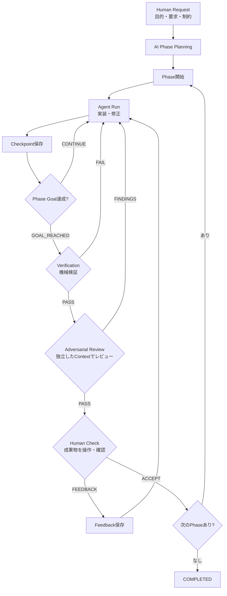

# AI Development Pipeline

`spec.md` の設計を実行可能なCLIにした、Phase指向のCoding Agentハーネスです。人間の要求を
レビュー可能な複数Phaseへ分割し、Agent Run、Checkpoint、機械検証、敵対的レビュー、
Human Checkを永続的な状態機械としてつなぎます。

## 実装済みのフロー



`init` はPhase開始まで、`run --until-ready` はHuman Check待ちまでを進めます。
Human Checkは自動承認せず、`human-check` でACCEPTまたはFEEDBACKを入力します。

* `initiative.json`、`state.json`、Phase定義を `work/<ID>/` に保存
* RunごとにMarkdown CheckpointとAgentログを保存
* 任意個のbuild/test/lintコマンドを実行し、結果とログをEvidenceとして保存
* 実装時とは独立したAgent呼び出しで、Reject理由を探す敵対的レビューを実行
* `ACCEPT` で次Phaseを自動開始し、`FEEDBACK` で同じPhaseのFix Runを開始
* stdin/stdoutの共通契約を介したCodex/OpenCodeアダプター
* JSONのatomic writeによる、Sessionに依存しない再開可能な状態管理

## 必要環境

* Python 3.11以上
* 利用するAgent CLI (`codex` または `opencode`) とその認証

以降の例はインストール不要のモジュール実行形式 `python3 -m dev_pipeline.cli` で表記します。
リポジトリルートから実行してください（`--repo` 等の相対パスは起動ディレクトリ基準のため）。
導入して `dev-pipeline` コマンドとして使いたい場合：

```bash
python3 -m pip install -e .
dev-pipeline --help
```

## クイックスタート

### 開発リポジトリの置き場（運用ルール）

新規開発では `work/<ID>/repo/` を基本の置き場とします。`--repo` を省略すると自動的に
`<work-dir>/<ID>/repo`（既定では `work/<ID>/repo`）へ解決され、`init` は未作成ならディレクトリを
作成します。別の場所を使いたい場合や既存リポジトリを改修する場合は、その場所を `--repo` で
明示します（明示した場合はディレクトリを自動作成せず、事前に用意してください）。

計画・実装・検証・レビューはすべて同じリポジトリを対象とします。既定の `work/<ID>/repo` を
使う運用では `--repo` の再指定は不要です。外部リポジトリへ `--repo` を明示した場合は、保存されないため
再開時も同じパスを指定してください。相対パスはCLIを起動したディレクトリから解決されるため、
以下の例は同じディレクトリで実行します。

### 1. 自然言語の要求から開始

新規開発では、先に成果物用のリポジトリをGitリポジトリとして初期化しておくことを推奨します
（`init` がディレクトリは作りますが、Gitの初期化は行いません）。既存リポジトリを使う場合は
作成不要で、以下の `--repo` をそのパスに置き換えます。

```bash
mkdir -p work/INIT-001/repo
git init work/INIT-001/repo
```

同じリポジトリを対象にPlanningします。Planningは人間の承認待ちで停止せず、
Phase 1を即座に `running` にします。`init` 自体は成果物を実装しません。

```bash
python3 -m dev_pipeline.cli --agent codex init \
  --id INIT-001 \
  --request "チームで使える軽量なタスク管理Webアプリを作る" \
  --constraint "SQLiteで動作すること"
```

Phaseを明示して再現性のある開始をする場合は、サンプル形式のJSONを渡します。この場合のみ
Planning Agentを呼びません。

```bash
python3 -m dev_pipeline.cli --repo work/INIT-001/repo init --id INIT-001 \
  --goal "タスク管理アプリを完成させる" \
  --requirement "タスクを登録・完了できる" \
  --phase-file examples/phases.json
```

### 2. Agent Runを実行

AgentはRepositoryを直接変更し、最終出力に共通JSON契約を返します。`GOAL_REACHED` の場合は
VerificationとAdversarial Reviewまで自動で進み、`CONTINUE` ならCheckpointを残して終了します。

機械検証はデフォルトで自動実行されます。実装エージェント(run)は自動テストに加えて、リポジトリ直下に
`devpipeline-tests.json` を書き、そこへ「テスト一式を実行するコマンド」を `{"command": "..."}` として
宣言します。`--check`・`init --check` が無い場合、検証はこのマニフェストのコマンドを実行します
（言語やフレームワークに依存しない）。マニフェストが無い・コマンドが無い場合は検証がFAILし、
次のrunでエージェントがテストとマニフェストを用意します。

* `--check 'NAME=COMMAND'` … そのrunだけ検証コマンドを差し替える（複数指定可）
* `init --check 'NAME=COMMAND'` … マニフェストに頼らず固定の検証コマンドを登録したい運用者向け
  （イニシアチブのデフォルトになる。登録値はマニフェストより優先）
* `--no-verify` … 機械検証をスキップし、レビューへ直行（opt-out）

```bash
# 何も指定しなくても動く（エージェントが宣言するマニフェストのテストを実行）
python3 -m dev_pipeline.cli --repo work/INIT-001/repo --agent codex run INIT-001 \
  --until-ready

# 固定の検証コマンドを使いたい場合
python3 -m dev_pipeline.cli --repo work/INIT-001/repo --agent codex run INIT-001 \
  --until-ready \
  --check 'test=pytest -q' \
  --check 'build=python3 -m build'
```

Human Checkまで自律的に継続する場合は `--until-ready` を指定します。`CONTINUE`、検証失敗、
レビュー指摘から次Runへ進み、Checkpoint・検証ログ・レビュー指摘を次のAgentへ渡します。
Human Checkは自動承認しません。Agentプロセス自体の起動・認証エラーは報告して終了します。

Codexの既定コマンドは `codex exec --sandbox workspace-write -` です。
認証済みCodex CLIの設定を使用し、モデルは固定しません。

OpenCodeでは同じコマンドの `--agent` を `opencode` に替えます。既定では
`opencode run --format json --dir <repoの絶対パス>` を起動し、JSONイベントから
最終回答だけを共通契約として取り出します。モデルはOpenCodeの設定を使用します。

```bash
python3 -m dev_pipeline.cli --repo work/INIT-001/repo --agent opencode run INIT-001 --until-ready \
  --check 'test=python3 -m unittest discover -v'
```

OpenCodeの最終回答が不正JSONの場合は、同じセッションに内容を変えず再出力を求めます。
権限拒否で回答前に終了した場合は、拒否を尊重し、許可範囲内の代替確認を促します。
復帰は1呼び出しにつき合計2回までで、権限の自動承認や設定変更はしません。
認証・API・プロセスエラーや復帰上限超過はログの場所を表示して停止します。
必要な権限が本当に不足している場合は、運用側で内容を確認してください。

各呼び出しのコマンド・Prompt・stdout・stderr・終了コードは、失敗分も含めて
`work/<ID>/agent-logs/` に保存します。ログには要求やソース内容が含まれ得るため、
共有時は内容を確認してください。検証済みのレビュー工程で停止した場合も、同じ
`run --until-ready` コマンドで保存済み状態から再開できます。

CLIオプションと権限の詳細は[OpenCode CLI](https://opencode.ai/docs/cli/)・
[Permissions](https://opencode.ai/docs/permissions/)を参照してください。
実機での復帰確認と新規E2Eの結果は[OpenCode実機検証](docs/opencode-e2e.md)に記録しています。

AgentのCLI引数が環境と異なる場合はコマンドを差し替えられます。Promptはstdinに渡されます。
`--agent-command` は選択したアダプターの起動コマンドを上書きします。
OpenCodeを選択した場合は、上書きしてもイベント抽出・セッション復帰を維持します。
OpenCode用のコマンドには `--format`・`--dir`・`--session` を含めず、アダプターに任せてください。
汎用の生JSON出力コマンドを使う場合は `--agent command --agent-command '任意のCLI'` とします。
以前の `--agent opencode --agent-command '生JSONを返す独自CLI'` も、この指定に変更してください。

```bash
python3 -m dev_pipeline.cli --repo work/INIT-001/repo --agent codex \
  --agent-command 'codex exec --sandbox workspace-write -' run INIT-001 \
  --check 'test=pytest -q'
```

### 3. 状態確認とHuman Check

```bash
python3 -m dev_pipeline.cli status INIT-001

# 人間可読な要約（トークン使用量の総数・内訳も表示）
python3 -m dev_pipeline.cli show INIT-001

# 成果物を操作して問題がなければ次Phaseへ
python3 -m dev_pipeline.cli human-check INIT-001 ACCEPT

# 修正が必要なら同じPhaseを継続
python3 -m dev_pipeline.cli human-check INIT-001 FEEDBACK \
  --feedback "検索後に戻っても条件を保持してほしい"
```

検証とレビューはトラブルシュート用に個別実行もできます。

```bash
python3 -m dev_pipeline.cli --repo work/INIT-001/repo verify INIT-001 --check 'test=python3 -m unittest discover -v'
python3 -m dev_pipeline.cli --repo work/INIT-001/repo --agent codex review INIT-001
```

## 永続化レイアウト

```text
work/INIT-001/
├── initiative.json
├── state.json
├── usage.json                     # 実行ごとのトークン使用量eventsと案件全体の累計
├── repo/                         # 新規開発の成果物（運用で作成。外部配置も可）
├── agent-logs/                   # Planning・Run・Reviewの全呼び出し（失敗・復帰分も保存）
├── phases/                       # Phase契約
├── runs/                         # Run Checkpoint
├── feedback/                     # ACCEPT / FEEDBACK
└── evidence/
    ├── phase-01-verification.json
    ├── phase-01-verification.log
    ├── phase-01-adversarial-review.json
    └── *-agent.log
```

`state.json` が現在地点のSource of Truthです。Agentプロセスが終了しても、同じ `--work-dir`・ID・`--repo` で
次のRunを開始できます。Verification失敗またはReview FindingsがあるPhaseはHuman Checkへ進みません。

## Agent出力契約

実装Runの最終JSON：

```json
{
  "result": "CONTINUE",
  "completed": ["APIを実装"],
  "remaining": ["UIを実装"],
  "problems": [],
  "recommended_next_action": "UIと統合テストを実装する"
}
```

レビューの最終JSON：

```json
{
  "result": "FINDINGS",
  "findings": [
    {
      "severity": "high",
      "description": "入力エラー時に値が失われる",
      "recommendation": "値を保持してエラーを表示する"
    }
  ]
}
```

Agentの最終回答は単一のJSON objectである必要があります。既定のOpenCodeアダプターは
CLIのJSONイベントから最終回答を抽出します。Codexおよび汎用commandアダプターの出力では、
stdout末尾が単一のJSON objectである必要があります（途中出力は許容）。

## プロンプトのカスタマイズ

Planning・実装run・敵対的レビューの各プロンプトは `dev_pipeline/prompts/`
（`planner.txt` / `run.txt` / `review.txt`）にテンプレートとして格納しています。
変数は `$変数名` 形式で、レンダリング時にコード側が埋め込みます（置換漏れは起動時にエラー）。
文言を調整したい場合は、環境変数 `DEV_PIPELINE_PROMPTS_DIR` で同名ファイルを置いた
ディレクトリを指定すると同梱テンプレートを差し替えられます。

```bash
export DEV_PIPELINE_PROMPTS_DIR=/path/to/my-prompts
```

プロンプトが指定する出力JSONのキーはコードが検証する契約のため、テンプレートの
`result`/`PASS|FINDINGS`/`findings` 等の構造を変えると実行が失敗します。文言の調整は
自由ですが、この出力契約は維持してください。

## トークン使用量の記録

Agentの実行ログ（stdoutのJSONL）からトークン使用量を抽出し、`usage.json` に実行単位の
eventsとして追記したうえで、案件全体の累計を毎回の保存時にeventsから再集計します。
累計を加算で持ち回らないため、再保存や再開で同一実行を重複計上しません。

* 収集元: Codexは `turn.completed.usage`、OpenCodeは `step_finish.part.tokens`
* 共通項目: input / cached_input / output / reasoning_output / total / reported_invocations
  * `total`は `input + output`。cached・reasoningは内訳であり二重加算しない
* 正規化: OpenCodeはinputにcache read/write、outputにreasoningを加算し、1実行内の複数
  stepを合算する。Codexの複数 `turn.completed` も1実行分に合算する
* 記録対象: Planning（`init`のAI計画）、各 `run`、`review` の成功実行に加え、停止した
  実行（`AgentError`）も保存済み `agent-logs/` からstdoutを回収して計上する
* 不正・欠損: 非JSON行・不正な使用量イベントは無視。欠損は0、負数・整数以外・真偽値は
  不正扱い。有効なイベントがなければその実行は未取得（記録しない）
* 表示: `show INIT-001` が総数と内訳を桁区切りで表示。`reported_invocations`が0なら
  `Token usage: unavailable`

```bash
python3 -m dev_pipeline.cli --agent opencode --token-usage-format opencode run INIT-001 ...
python3 -m dev_pipeline.cli show INIT-001
```

抽出形式は明示の `--token-usage-format` が最優先で、未指定なら各アダプターの形式
（codex / opencode）へ、未知の明示値は起動前に拒否されます。新しい出力形式は
`usage.TOKEN_USAGE_EXTRACTORS` への抽出関数登録で追加できます。

互換上の注意: `reported_invocations` はCodexでは有効な完了イベント数、OpenCodeでは
使用量を取得できた実行数です。料金換算は行いません。

## Agentの追加・差し替え

PipelineとPlanningは `Agent.execute(prompt, repository) -> AgentResult` だけに依存します。
具体的なCLIの引数・出力解析・セッション復帰は各アダプターが担当します。

```text
dev_pipeline/agents/
├── base.py       # Agent Protocol・共通結果／例外・JSON抽出
├── process.py    # プロセス実行・作業ディレクトリ・ログ保存
├── command.py    # 汎用stdin → 生JSON stdout
├── codex.py      # Codexの起動設定
├── opencode.py   # OpenCodeのイベント解析・セッション復帰
└── __init__.py   # アダプター登録・生成
```

新しいCLIが共通の生JSON契約を満たす場合は、実装を追加せずに利用できます。

```bash
python3 -m dev_pipeline.cli --repo work/INIT-001/repo --agent command \
  --agent-command 'my-agent run' run INIT-001 --until-ready \
  --check 'test=python3 -m unittest discover -v'
```

独自形式のCLIは、`execute`を持つアダプターを追加し、`AGENT_FACTORIES`に名前と
ファクトリーを登録します。ファクトリーは `(command, log_dir)` を受け取ります。
PipelineやCLIの選択肢を修正する必要はありません。CLI型アダプターは`ProcessRunner`を再利用でき、
CLI以外のAgentも`AgentResult`を返すだけで接続できます。継承や動的プラグイン機構は必須にしていません。

## 開発時の検証

```bash
python3 -m unittest discover -v
python3 -m compileall -q dev_pipeline tests
```
