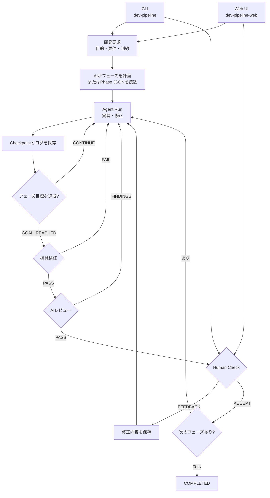

# AI開発パイプライン

開発要求を複数のフェーズへ分け、Coding Agentによる実装、機械検証、AIレビュー、人間の承認を順番に進めるローカル実行基盤です。
操作方法は、ターミナルから直接実行するCLIと、PC・スマートフォン向けWeb UIの2通りです。どちらも同じ `work/` の状態と成果物を扱います。

## パイプライン全体



機械検証とAIレビューが通っても自動承認はしません。成果物を実際に確認し、各フェーズで `ACCEPT` または `FEEDBACK` を入力します。状態、結果、ログはファイルへ保存されるため、プロセス終了後も再開できます。

## 必要環境とインストール

- Python 3.11以上
- Git
- 利用するAgent CLI（Codex、OpenCode、Antigravityのいずれか）とその認証

```bash
python3 -m venv .venv
source .venv/bin/activate
python -m pip install -e '.[web]'
```

CLIだけを使う場合は `python -m pip install -e .` でも構いません。インストール後は次の2コマンドが利用できます。

- `dev-pipeline`: パイプラインを直接操作するCLI
- `dev-pipeline-web`: 同じCLIをバックグラウンド実行するWeb UI

## CLIで直接実行する (Project + Issue 駆動)

パイプラインは「リポジトリと共通設定を持つ **Project**」と「個々の開発要求を持つ **Issue**」の2層構造で動作します。

### 1. プロジェクトの準備

```bash
# プロジェクト初期化 (リポジトリ作成または既存リポジトリバインド)
dev-pipeline project init my-app --agent codex

# プロジェクト一覧・詳細確認
dev-pipeline project list
dev-pipeline project show my-app
```

### 2. Issueの作成と実行

```bash
# 新規Issueの作成 (自動計画・初期Run開始)
dev-pipeline issue create my-app \
  --id 0001-user-auth \
  --request "ユーザー認証機能を追加する" \
  --requirement "登録とログインができる"

# 状態確認・承認
dev-pipeline issue status my-app 0001-user-auth
dev-pipeline issue human-check my-app 0001-user-auth ACCEPT
dev-pipeline issue run my-app 0001-user-auth --until-ready
```

Issueの最終フェーズが承認されると、そのIssueは `RESOLVED`（解決済み）となります。リポジトリはそのまま保持され、同じプロジェクトで次のIssue（例: `0002-csv-export`）を開始した際、過去に解決されたIssueの文脈（`$resolved_issues`）が自動的にプロンプトへ引き継がれます。

*(後方互換性のため、従来の `dev-pipeline init --id INIT-001 ...` や `dev-pipeline run ...` も引き続き利用可能です)*

## Web UIで操作する

ローカルで起動します。

```bash
dev-pipeline-web --work-dir /絶対パス/work
```

PCやスマートフォンのブラウザーで `http://127.0.0.1:8787` を開きます。
画面上部のプロジェクトセレクターから対象プロジェクトを切り替え、プロジェクトごとのIssue一覧、新規Issue作成、進捗・ログ確認、承認、修正依頼を行えます。

スマートフォンからの接続、Tailscale、通知は[Web UI・スマートフォン操作ガイド](docs/mobile-operations.md)、macOSでの常時起動は[launchd常時起動ガイド](docs/launchd.md)を参照してください。

## 保存先

```text
work/<プロジェクトID>/
├── project.json                # プロジェクト設定 (リポジトリパス、標準エージェント、共通チェック)
├── repo/                       # プロジェクト既定のGitリポジトリ
└── issues/
    └── <Issue ID>/             # 例: 0001-user-auth
        ├── issue.json          # Issueの目的・要件・フェーズ順
        ├── state.json          # 現在の状態（Source of Truth）
        ├── usage.json          # トークン使用量・Agent割り当て使用率
        ├── phases/             # フェーズ定義
        ├── runs/               # RunごとのCheckpoint
        ├── feedback/           # ACCEPT / FEEDBACKの記録
        └── evidence/           # 検証・レビュー結果
```

外部リポジトリを `--repo` で指定した場合、成果物は `work/` の外に置かれます。再開時も同じ `--work-dir`、案件ID、リポジトリを使用してください。

## ドキュメント

- [CLI操作ガイド](docs/cli-operations.md): ターミナルからの作成、実行、確認、承認、再開
- [Web UI・スマートフォン操作ガイド](docs/mobile-operations.md): 画面操作、Tailscale、通知
- [launchd常時起動ガイド](docs/launchd.md): macOSログイン時の自動起動と管理
- [トラブル対応](docs/troubleshooting.md): 利用者・管理者向けの切り分け
- [業務仕様](spec.md): 役割、承認基準、安全上の境界
- [Antigravity実行安定性 調査レポート](docs/antigravity-stability-report.md): 既知の挙動と改善案

## 利用上の注意

- 自動テストとAIレビューの合格は、業務上の正しさを保証しません。承認前に成果物を実際に確認してください。
- `human-check ... ACCEPT` は取り消しを前提としていません。
- 実行停止やプロセス終了は、それまでのファイル変更を取り消しません。
- Agentログには要求やソース内容が含まれる場合があります。共有前に内容を確認してください。
- パイプラインの完了は、本番公開やデプロイを意味しません。

## 開発時の検証

```bash
python3 -m unittest discover -v
python3 -m compileall -q dev_pipeline tests
```
