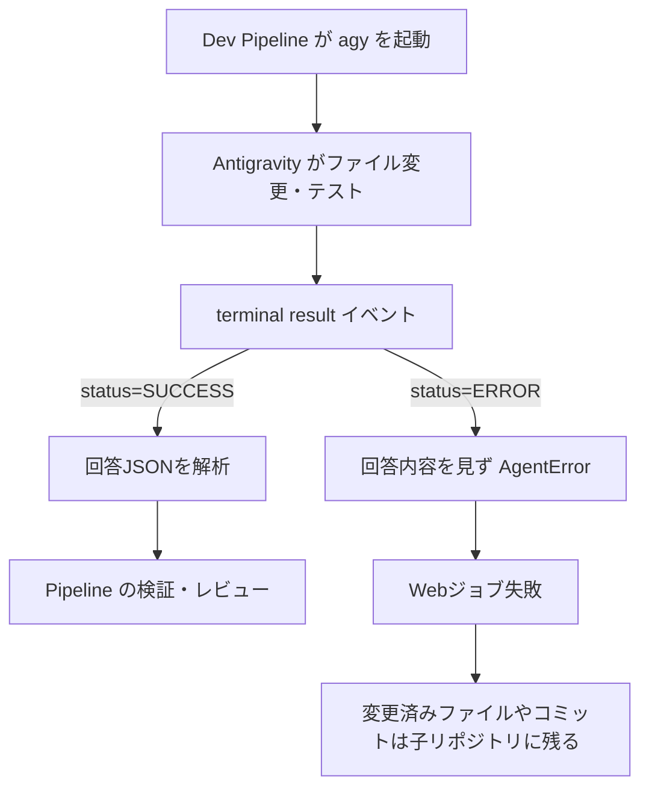
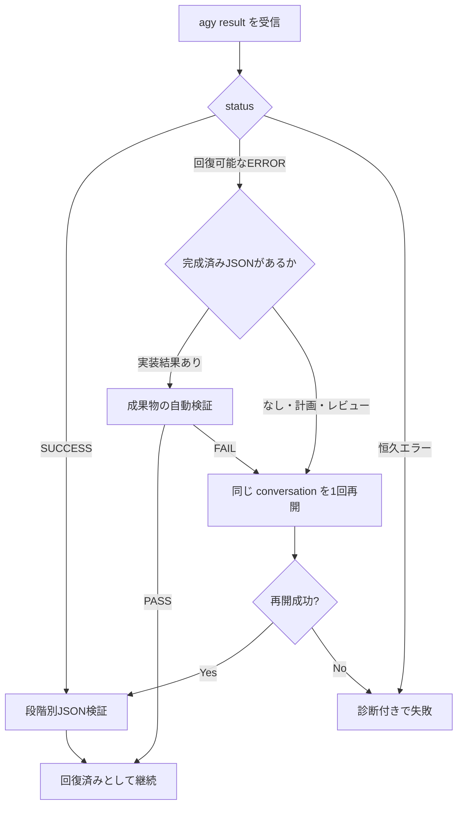

# Antigravity 実行安定性 調査レポート

調査日: 2026-09-06  
対象: Dev Pipeline の Antigravity (`agy`) アダプターと、ローカル `work/` に残る実行記録

## 結論

「Antigravity が毎回落ちている」のではなく、次の3つが重なっている。

1. 旧設定では Antigravity 標準の5分タイムアウトに到達していた。この問題は現在の `--print-timeout 40m` で対策済み。
2. Antigravity が作業と最終回答を完了した後でも、上流ストリームの一時エラーにより最終 `status` が `ERROR` になることがある。Dev Pipeline は完成済みの回答を無条件に破棄するため、実害のないエラーもジョブ失敗になる。
3. `ProcessRunner` が標準出力を終了までバッファするため、長時間の正常実行も Web UI からは無反応に見える。確認できた正常実行の最長は約20分だった。

根本対策は、Antigravity のエラーを無視することではない。**回復可能なエラーだけを分類し、同じ `conversation_id` で1回だけ再開すること**、および**すでに完成した実装結果は自動テストで検証して救済すること**である。併せて、実行中の `step_update` を Web UI に表示する。

## 調査結果

Antigravity の記録がある3案件、全19呼び出しを調べた。

| 案件 | 呼び出し | 成功 | エラー | 最長時間 | 所見 |
|---|---:|---:|---:|---:|---|
| `CSV-AGY-01` | 4 | 4 | 0 | 258秒 | 計画・実装・検証・レビューまで完了 |
| `INIT-4d9e23321bab` | 6 | 5 | 1 | 415秒 | 1件は成果物・テスト・コミット・最終JSONまで完成後に `ERROR` |
| `CRYPTO-NAUT-01` | 9 | 8 | 1 | 1,202秒 | 1件は旧設定の約5分タイムアウト。その後の40分設定では長時間実行も成功 |
| **合計** | **19** | **17** | **2** | **1,202秒** | 観測上のエラー率は10.5%。2件の原因は異なる |

この件数は傾向を断定できる規模ではないが、少なくとも「常にプロセスがクラッシュする」という状態ではない。なお、`work/` は Git 管理外なので、表の根拠ログはこの端末上にだけ存在する。

### 失敗1: 旧設定の5分タイムアウト

- 記録: `work/CRYPTO-NAUT-01/agent-logs/5f4886e1cef646a285b5499e076f2997-1.json`
- 結果: `status=ERROR`, `error="timeout waiting for response"`, 終了コード1
- 経過時間: 297.49秒
- 実行コマンドには `--print-timeout` がなかった

Antigravity の既定タイムアウトは5分である。現在のアダプターは `--print-timeout 40m` を自動付与するため、この原因はすでに解消している。実際に同じ `CRYPTO-NAUT-01` では、設定変更後に約20分の呼び出しが成功している。

### 失敗2: 作業完了後の偽失敗

- 記録: `work/INIT-4d9e23321bab/agent-logs/ecf081651e7c4519b4b37b4a68ec3213-1.json`
- 結果: プロセス終了コード0、`status=ERROR`
- エラー: `The stream was interrupted. Please continue the task you were working on.`
- 経過時間: 415.42秒

この呼び出しでは、エラーになる前に次が完了していた。

- アプリ実装とドキュメント作成
- `npm test`: 15件成功
- `npm run build`: 成功
- Git コミット作成
- `result=GOAL_REACHED` を持つ有効な最終JSONの生成

Antigravity の内部ログには途中で HTTP 500 相当の内部エラーと自動再試行が記録され、その後も処理は最後まで進んでいる。最終的に入力ストリームは1ターン完了として閉じられているため、少なくともローカルプロセスの強制終了ではない。上流エラー後の状態が最終 `ERROR` に残った可能性が高いが、ログだけから上流側の厳密な原因までは断定できない。

現在の `AntigravityAgent.execute()` は `status != SUCCESS` を最初に検査する。そのため、`response` 末尾に有効な結果JSONがあり、成果物も完成していても `AgentError` にして捨てる。Webジョブはいったん失敗になったが、再実行は成功し、案件は最終的に `AWAITING_HUMAN_CHECK` まで進んだ。

## 現在の失敗経路

この経路では「実装が失敗した」のか「通信の最後だけ失敗した」のかを区別できない。また、`subprocess.run(capture_output=True)` により、Bの間は Web UI に途中経過が出ない。

## 推奨する解決策

### P0: 回復可能な中断を同一conversationで1回だけ再開する

`result` イベントから `conversation_id`、`status`、`error`、`response` を保持し、次を区別する。

- 回復候補: `stream was interrupted`、タイムアウト、一時的な上流障害
- 即時失敗: 認証失敗、設定不正、未知モデル、入力プロトコル不正、明示的キャンセル

回復候補では、新規会話で元の作業を最初から再実行せず、`agy --conversation <id>` で1回だけ再開する。再開プロンプトでは、既存成果物を確認し、完了済み作業を繰り返さず、要求された最終JSONだけを返すよう指示する。

無制限再試行は行わない。ファイル変更、依存関係インストール、Gitコミットなどの副作用が重複するためである。

### P0: 完成済みの実装結果を段階別に救済する

エラー時の `response` が有効な最終JSONであっても、すべてを無条件に成功扱いしてはいけない。段階ごとに扱う。

| 段階 | 回復候補時の扱い |
|---|---|
| 実装 (`run`) | `GOAL_REACHED` / `CONTINUE` の構造を検証し、決定論的な `verify` を必ず実行する。検証成功時だけ処理を継続 |
| レビュー | `PASS` をそのまま採用せず、同一conversationで最終判定を再発行させる。再開不能ならレビューを再実行 |
| 計画 | 同一conversationで構造化結果を再発行させる。計画には自動テストによる救済がないため、エラー回答を直接採用しない |

この設計なら、今回の `INIT-4d9e23321bab` は既存成果物に対して検証へ進める一方、不完全な作業を `GOAL_REACHED` の文字列だけで成功扱いする事故を防げる。

### P0: 試行単位のログを関連付ける

OpenCode アダプターと同様に、1論理呼び出しへ共通の invocation ID を割り当て、`attempt-1`, `attempt-2` を関連付ける。最終エラーには、全試行のログパス、conversation ID、回復を試みたかを残す。

同一conversationの使用量は累積値になり得るため、再開前後の差分を記録するか、conversation IDごとに最大値だけを集計し、トークンを二重計上しない。

### P1: Web UI へ進捗をストリーミングする

`ProcessRunner` を終了待ちの `subprocess.run()` から、標準出力を1行ずつ読む `Popen` ベースへ変更する。`step_update` から次だけをジョブログへ流す。

- 経過時間
- 現在のステップ種別
- ツール名
- 最終イベント受信時刻
- `running` / `recovering` / `verifying` の状態

プロンプト全文やツール出力全文は画面へ流さず、既存の詳細ログにだけ保存する。これにより、10〜20分の正常実行が「停止」に見える問題を解消できる。

### P1: 外側にも監視タイムアウトを置く

現在は Antigravity 内部の40分タイムアウトだけで、`ProcessRunner` 自体には上限がない。CLIが完全にハングした場合に備え、外側へ45分程度のハードタイムアウトを置く。必ず内側の `--print-timeout 40m` より長くし、Antigravity自身が結果イベントと診断を出す猶予を確保する。

### P1: `--json-schema` で最終出力を制約する

Antigravity は最終結果への JSON Schema 適用をサポートしている。計画・実装・レビューごとのスキーマを渡せるよう Agent インターフェースを拡張し、自由文末尾からJSONを探索する現在の方式を補強する。

これはストリーム切断そのものを防がないが、再開後の「JSONだけ再発行」を安定させ、壊れた結果を早期に検出できる。

### P2: 権限設定は安定性対策と分離する

`--dangerously-skip-permissions` の有無と今回の2エラーには相関がない。これをクラッシュ対策として一律に付けるべきではない。公式推奨どおり、必要な `git`、テスト、ビルド等だけを scoped permission として許可する。

ブラウザ検証が必要な案件では、今回の内部ログに Playwright ドライバー取得失敗もあったため、実行前の capability check として分離して表示する。ただし、これは今回の最終ストリーム中断の直接原因とは確認できない。

## 改修後のフロー

## 受け入れテスト

改修時には少なくとも次を自動化する。

1. 5分を超える正常実行が `--print-timeout 40m` で成功する。
2. `status=ERROR` でも、有効な `GOAL_REACHED` と成功する検証がある実装は回復できる。
3. `status=ERROR` かつ最終JSONなしの場合、同一conversationを1回だけ再開する。
4. 認証・設定・プロトコル不正は再試行せず、元の診断を保持して失敗する。
5. レビューの `PASS` をエラー応答から直接採用しない。
6. 再開時に既存コミットや依存関係インストールを重複させない。
7. 再開前後の使用量を二重計上しない。
8. 外側タイムアウト時にも部分ログ、conversation ID、最後の進捗時刻を残す。
9. Webジョブログへ一定間隔で進捗が出る。

## 実装順序

1. `AntigravityAgent` に結果分類、conversation ID保持、1回の再開を実装する。
2. Pipeline に実装段階だけの「最終JSON + 自動検証」救済を実装する。
3. 試行ログの関連付けと使用量の重複排除を実装する。
4. `ProcessRunner` のストリーミング化と Web UI の進捗表示を実装する。
5. 外側タイムアウト、JSON Schema、capability check を追加する。

## 参照

- [Antigravity Headless mode](https://www.agy.dev/docs/cli/headless/): ストリームイベント、`conversation_id` による再開、エラー状態、既定5分の `--print-timeout`、`--json-schema`、権限設定
- [Antigravity CLI changelog](https://www.agy.dev/changelog?tab=cli): v1.1.18のストリーム切断検出、v1.1.20のheadlessエラー処理変更
- `dev_pipeline/agents/antigravity.py`: 現在の最終ステータス判定
- `dev_pipeline/agents/process.py`: 終了まで出力をバッファする現在のプロセス実行
- `dev_pipeline/agents/opencode.py`: invocation IDと限定再試行の既存実装例

