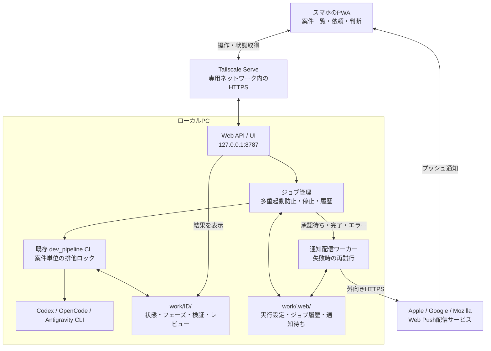
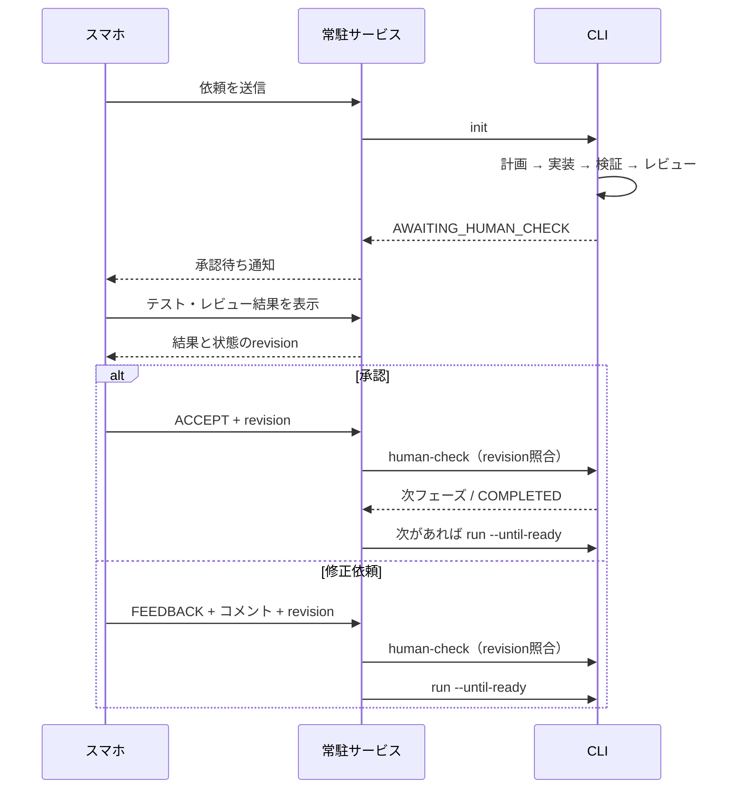

# スマホからのローカル運用

ローカルPCでパイプラインを動かし、スマホでは依頼・進捗確認・テスト結果とレビュー結果の確認・承認・差し戻し・停止・再開を行います。成果物のプレビュー、開発サーバーの公開、リポジトリ内の任意ファイル配信は行いません。

## 構成



処理はローカルPCで実行します。通知はブラウザーのWeb Push配信基盤を経由します。通知から開く画面はTailscale内にあり、操作時にはスマホのTailscale接続が必要です。

## 1. ローカル起動

Python 3.11以上、Git、利用するエージェントCLIのインストールと認証が必要です。macOS / Linux向けです。

リポジトリルートで実行します。

```bash
python3 -m venv .venv
source .venv/bin/activate
python -m pip install -e '.[web]'
dev-pipeline-web --work-dir /絶対パス/work
```

PCのブラウザーで `http://127.0.0.1:8787` を開きます。通知の設定がなくても、案件の操作と結果確認は利用できます。

`--work-dir` は既存CLIと同じ保存先にしてください。CLIで作成済みの案件も一覧に表示されます。既存案件で外部リポジトリを使っていた場合、詳細画面の「実行設定」でそのパスとエージェントを指定してから再開します。Webから設定したパスとエージェントは保存されます。

新規依頼でリポジトリ欄を空にすると、`work/<ID>/repo` を作成し、Git初期化してから計画・実装を開始します。既存パスを指定した場合は、その場所を使用します。

## 2. Tailscaleから接続

PCとスマホにTailscaleを導入し、同じ専用ネットワークに接続します。PCで次を実行し、表示されたHTTPS URLを控えます。

```bash
tailscale serve --bg 8787
```

Webサービスを一度終了し、実際のURLと許可するTailscaleログイン名を指定して再起動します。

```bash
dev-pipeline-web \
  --work-dir /絶対パス/work \
  --public-url https://YOUR-PC.YOUR-TAILNET.ts.net \
  --allow-user you@example.com \
  --push-subject mailto:you@example.com
```

スマホでそのHTTPS URLを開きます。`--allow-user` はTailscaleのログイン名で、複数指定できます。指定した場合、Tailscale Serveを通していないlocalhostアクセスも拒否します。URLのHostは登録値と照合し、変更操作は同一OriginとCSRFトークンを確認します。

Webサービスはlocalhostだけで待ち受けます。Serve側では許可する端末・ユーザーをTailscaleのアクセス制御で限定してください。公開用のFunnelはこの構成には使用しません。

## 3. スマホの通知

1. iPhoneではSafariの共有メニューから「ホーム画面に追加」し、そのアイコンから開きます。iOS 16.4以降が必要です。
2. Androidでは対応ブラウザーからホーム画面に追加するか、そのままブラウザーで使用します。
3. 画面右上の「通知設定」→「通知を有効にする」で端末の通知を許可します。
4. 「テスト通知」で実際の着信を確認します。

`--push-subject` はWeb Push送信者の連絡先です。有効な自分のメールアドレスを `mailto:` 付きで指定してください。環境変数 `DEV_PIPELINE_PUSH_SUBJECT` でも設定できます。

VAPID秘密鍵は初回に自動生成し、`work/.web/vapid.pem` に保存します。購読情報と未配信通知も同じディレクトリに保存します。VAPID鍵を失うと端末での通知再登録が必要になります。

配信失敗は30秒ごとに再試行し、24時間経過した通知は破棄します。失効した購読は削除します。「通知設定」に最後の配信エラーを表示します。通知は端末の集中モードなどにも左右されるため、承認待ち一覧が状態確認の基準です。

## 操作と状態遷移



| 操作 | 動作 |
|---|---|
| 新規依頼 | 計画から最初の承認待ちまで実行 |
| 実行を開始・再開 | 保存済み状態から承認待ちまで実行 |
| 承認して次へ | 確認した状態と一致する場合だけ承認し、次フェーズを実行 |
| 承認して完了 | 最終フェーズを承認し、案件を完了 |
| 修正を依頼 | コメントを保存し、同じフェーズの修正を実行 |
| 実行を停止 | CLIと子プロセス群を終了。途中のファイル変更は保持 |
| 再実行 | 実行エラー後に保存済み状態から再開。初期計画の失敗は計画から再試行 |

判断を保留する場合は承認待ちのまま閉じます。通知からのアクセス自体では承認されません。操作は案件IDだけでなく、フェーズ・Run・更新状態を含むrevisionと照合するため、古い画面から別の成果を承認できません。通信失敗後の同じ要求の再送にはrequest IDを使い、同じジョブを返します。

検証・レビュー画面では過去のフェーズも選択できます。表示するのは各フェーズで最後に保存した結果です。修正中は前回の結果が残るため、Run番号と時刻を併記します。ログは末尾100KBまで表示します。

## Macで常駐させる

ターミナルを閉じても運用するにはlaunchdを使います。[launchd設定例](../examples/dev-pipeline-web.plist)をコピーし、次を実環境の絶対パス・値に置き換えます。

- プロジェクトの場所と仮想環境のPython
- `--work-dir`、`--public-url`、`--allow-user`、`--push-subject`
- エージェントCLIが見つかる`PATH`と、stdout/stderrログの保存先

ログ保存先のディレクトリを作成し、設定を `~/Library/LaunchAgents/local.dev-pipeline.web.plist` に置いてから登録します。

```bash
launchctl bootstrap gui/$(id -u) ~/Library/LaunchAgents/local.dev-pipeline.web.plist
```

停止・設定更新時の登録解除：

```bash
launchctl bootout gui/$(id -u) ~/Library/LaunchAgents/local.dev-pipeline.web.plist
```

LaunchAgentはログイン中に動作します。電源とネット接続を維持し、Macの電源設定でスリープを防ぐ運用にしてください。CLI認証はこのサービスを動かすユーザーで事前に済ませます。OS再ログインや認証のやり直しまで自動化するものではありません。

## 保存先と復旧

```text
work/
├── <ID>/                         # 既存CLIと共通
│   ├── .execution.lock           # CLIのプロセス間排他
│   ├── state.json
│   ├── initiative.json
│   ├── phases/ runs/ feedback/
│   └── evidence/ agent-logs/ repo/
└── .web/
    ├── service.lock              # 同じ保存先への二重サービス起動を防止
    ├── settings.json             # 案件ごとのエージェント・パス・初期依頼
    ├── jobs.json                 # ジョブ履歴・再送ID
    ├── job-logs/                 # CLIのstdout/stderr
    ├── notifications.json        # 通知購読・未配信通知
    └── vapid.pem                 # 通知用秘密鍵
```

通常のサービス終了では実行中のジョブを停止します。再起動後、スマホで状態を確認して再開します。異常終了時の実行履歴は「中断」として表示し、勝手に再実行しません。PCの強制終了などではチェックポイント未保存の変更が残り得ます。サービスだけが強制終了してCLIが残っている場合、CLIの排他ロックが重複実行を拒否します。そのプロセスが終了するまで再開できません。

操作画面はオフラインでの承認をキューに保存しません。Webサービス停止・Tailscale切断時は接続エラーを表示します。スマホの画面を閉じること自体はジョブを停止しません。

## 実装の対応

| ファイル | 役割 |
|---|---|
| `dev_pipeline/web_server.py` | localhost HTTP、API、Host/Origin/CSRF確認、静的UI配信 |
| `dev_pipeline/web_service.py` | CLIジョブ、停止、履歴、実行設定、結果読み取り |
| `dev_pipeline/notifications.py` | VAPID、通知購読、配信と再試行 |
| `dev_pipeline/webui/` | スマホ用UI、PWA、Service Worker |
| `dev_pipeline/store.py` | 既存の永続化とCLI排他ロック |
| `dev_pipeline/pipeline.py` | Human Check時のrevision照合 |

検証コマンド：

```bash
source .venv/bin/activate
python -m unittest discover -v
```

Webの統合テストは、外部AIを呼ばないテスト用エージェントを別プロセスで動かし、CLIによる計画・検証・レビュー・差し戻し・次フェーズ・完了を通します。Web Pushは鍵生成・保存、配信失敗と再試行をローカルで検証します。実端末への着信とTailscale経由の接続は、上記の初期設定後に「テスト通知」で確認してください。

参考：[Tailscale Serve](https://tailscale.com/docs/features/tailscale-serve)、[iOS Web Push](https://webkit.org/blog/13878/web-push-for-web-apps-on-ios-and-ipados/)、[pywebpush](https://github.com/web-push-libs/pywebpush)
